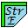
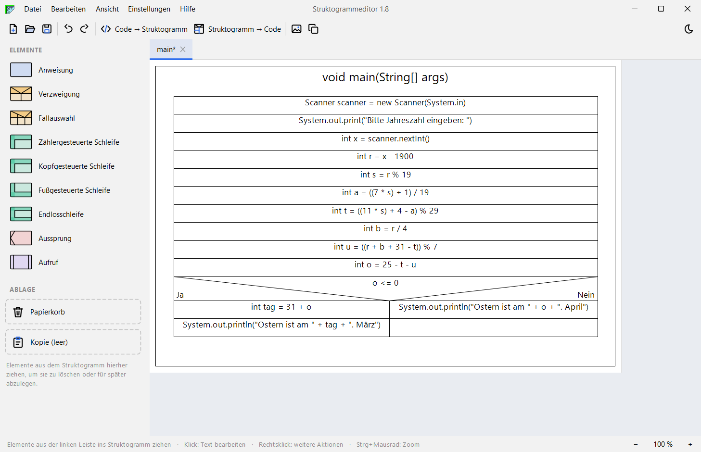
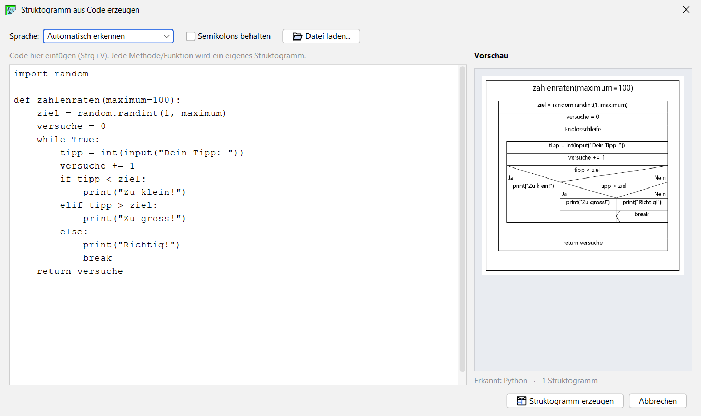
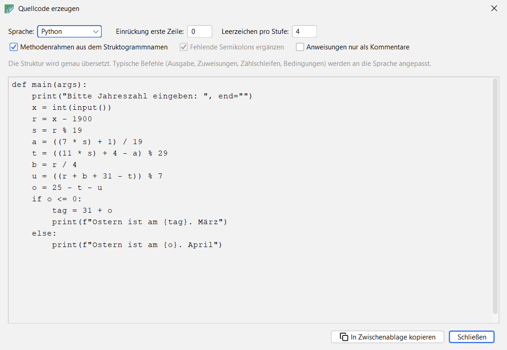
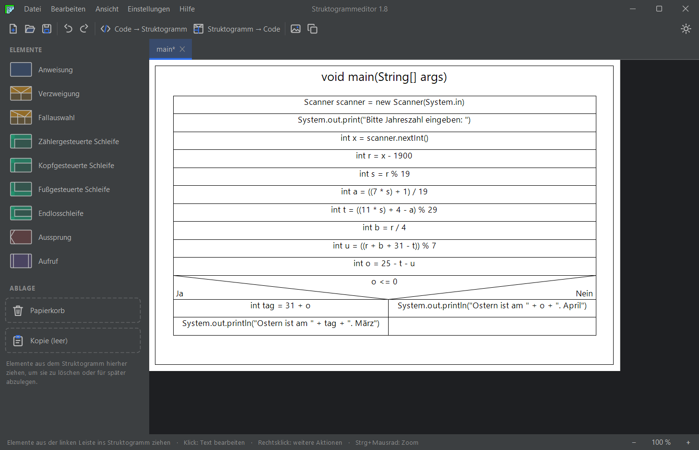

<p align="center">
  
</p>

<h1 align="center">Struktogrammeditor</h1>

<p align="center">
  Struktogramme (Nassi-Shneiderman-Diagramme) zeichnen, aus Quellcode erzeugen und wieder in Code umwandeln.
</p>

<p align="center">
  <a href="https://github.com/malik-creates/Struktogrammeditor/releases/latest"></a>
  <a href="https://github.com/malik-creates/Struktogrammeditor/actions"></a>
  
  <a href="LICENSE"></a>
</p>

<p align="center">
  
</p>

---

## Funktionen

| Funktion | Beschreibung |
|---|---|
| 🧩 **Zeichnen per Drag & Drop** | Anweisungen, Verzweigungen, Fallauswahl, Schleifen, Aussprung und Aufruf aus der Leiste ins Struktogramm ziehen |
| ⬅️ **Struktogramm aus Code** | Java, C, C++, C#, JavaScript, Python und Pascal/Delphi einfügen – die Sprache wird automatisch erkannt, jede Funktion wird ein eigenes Struktogramm |
| ➡️ **Code aus dem Struktogramm** | Java, C#, JavaScript, C/C++, Python und Pascal – Ein-/Ausgabe, Zuweisungen, Zählschleifen und Operatoren werden an die Sprache angepasst |
| 📄 **Export** | PDF und SVG als Vektorgrafik, PNG in doppelter Auflösung (scharf in Word) oder direkt in die Zwischenablage |
| 🔍 **Zoom** | ganze Ansicht mit Strg + Mausrad vergrössern, scharf auch bei Windows-Skalierung |
| 🌙 **Hell & dunkel** | modernes Design, mit einem Klick umschaltbar |
| 💾 **Automatische Sicherung** | ungespeicherte Struktogramme werden nach einem Absturz beim nächsten Start angeboten |

## Struktogramm aus Code erzeugen

Code einfügen oder eine Datei laden – rechts erscheint schon beim Tippen die Vorschau. Fehler werden mit Zeilennummer angezeigt.

<p align="center">
  
</p>

## Code aus dem Struktogramm erzeugen

Sprache wählen, fertig. Der Code aktualisiert sich bei jeder Änderung der Optionen und lässt sich mit einem Klick kopieren.

<p align="center">
  
</p>

## Dunkles Design

<p align="center">
  
</p>

## Download und Start

1. [Java](https://adoptium.net/) 8 oder neuer installieren (falls noch nicht vorhanden).
2. Die neueste `Struktogrammeditor-….jar` unter **[Releases](https://github.com/malik-creates/Struktogrammeditor/releases/latest)** herunterladen.
3. Per Doppelklick starten – oder im Terminal:

```bash
java -jar Struktogrammeditor-1.8.jar
```

## Bedienung

| Aktion | So geht's |
|---|---|
| Element einfügen | aus der linken Leiste ins Struktogramm ziehen |
| Text bearbeiten | Element anklicken |
| Weitere Aktionen (Fälle, Kopieren, Grösse) | Rechtsklick auf ein Element |
| Element verschieben | im Struktogramm an die neue Stelle ziehen |
| Element löschen | auf den Papierkorb ziehen oder Maus darüber + `Entf` |
| Struktogramm aus Code | `Strg + I` |
| Ansicht zoomen | `Strg + Mausrad`, `Strg + Plus/Minus`, `Strg + 0` |
| Rückgängig / Widerrufen | `Strg + Z` / `Strg + Y` |

Beispiele zum Ausprobieren liegen im Ordner [`beispiele`](beispiele).

## Selbst bauen

Es wird nur Java benötigt, Maven lädt sich über den Wrapper selbst herunter.

```bash
# Windows (PowerShell)
.\mvnw.cmd clean package

# Linux / macOS
./mvnw clean package
```

Die ausführbare Datei liegt danach unter `target/struktogrammeditor-1.8-jar-with-dependencies.jar`.

## Herkunft und Lizenz

Erweiterte Fassung von [malik-creates](https://github.com/malik-creates), basierend auf dem [Struktogrammeditor von Kevin Krummenauer](https://github.com/kekru/struktogrammeditor).

Veröffentlicht unter der [MIT-Lizenz](LICENSE). Enthält [JDOM](http://www.jdom.org/) und [FlatLaf](https://www.formdev.com/flatlaf/) (Apache License 2.0).
